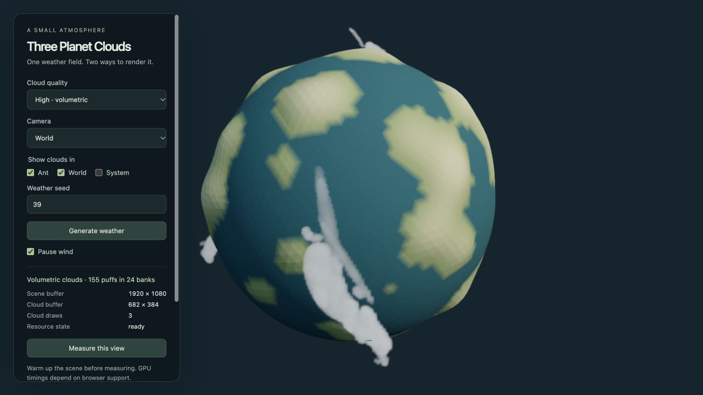

# Three Planet Clouds



Seeded planetary clouds for Three.js, extracted from **ant-world**. A shared field of ellipsoids supports two rendering modes:

- **Low:** one instanced draw, shaded ellipsoids, no density textures.
- **High:** a single spherical-shell raymarch, a baked angular envelope, periodic 3D density noise, and depth-aware reconstruction.

Both modes use the same regional weather layout and wind transform. High falls back to Low while resources load or if the required graphics features are unavailable. Visibility is independently configurable for **Ant**, **World**, and **System** views.

Built by Robin Stethem. This work was informed by [Faraz Shaikh’s envelope-based clouds](https://github.com/FarazzShaikh/three-volumetric-clouds), [Leonardo Soares Gonçalves’s volumetric clouds](https://github.com/leoawen/volumetric-clouds), and [Shota Matsuda / Takram’s three-clouds](https://github.com/takram-design-engineering/three-geospatial/tree/main/packages/clouds). See [Credits](CREDITS.md) for the specific influences and shader attributions.

## Run the demo

Use Node.js 22 or newer:

```sh
npm ci
npm run dev
```

Open **http://127.0.0.1:4173**. No build step, CDN, account, or external texture downloads are needed. The demo includes both quality modes, three camera presets, per-view visibility switches, seeded regeneration, wind pause, and an optional measurement capture.

```sh
npm test
npm run format:check
npm pack
```

This is a local source release; the package name is not a claim of npm availability. To use it in another project, install the tarball produced by `npm pack`, together with **Three.js 0.169.0**. That exact peer version is deliberate: High patches shader compilation and relies on renderer behavior tested against r169.

## Minimal integration

```js
import * as THREE from 'three';
import { createCloudSystem } from 'three-planet-clouds';

// scene, camera, and renderer belong to your application.
// Render one planet centered at (0, 0, 0), in the library's small-world units.
renderer.toneMapping = THREE.ACESFilmicToneMapping;
renderer.outputColorSpace = THREE.SRGBColorSpace;
renderer.setClearColor('#10252e');

const clouds = createCloudSystem({
  scene,
  renderer,
  terrainRadius: 43, // upper bound of the terrain surface
  planetRadius: 40, // solid sphere used to block sunlight
  seed: 39,
  storage: null, // disable persistence; omit to use localStorage
});

clouds.setPreferences({
  quality: 'low',
  ant: true,
  world: true,
  system: false,
});

const clock = new THREE.Clock();
function frame() {
  requestAnimationFrame(frame);
  clouds.update(Math.min(clock.getDelta(), 0.1), {
    view: 'world', // 'ant', 'world', 'system', or null to hide
    sunDirection: new THREE.Vector3(-0.4, 0.8, 0.5).normalize(),
  });
  // This renders the complete scene. Do not render it again afterward.
  clouds.render(scene, camera);
}
frame();

// After renderer.setSize(...) and camera projection updates:
clouds.resize();

// On teardown, after stopping your animation loop:
clouds.dispose();
```

Reuse the sun vector in a real animation loop; it is created inline above to keep the example self-contained. Cameras must use conventional WebGL depth. Host the modules over HTTP(S); the High resource baker is a module worker. See [Integration](docs/INTEGRATION.md) for bundlers, custom materials, ownership, and unsupported configurations.

## What is included

| Part            | Implementation                                                                                               |
| --------------- | ------------------------------------------------------------------------------------------------------------ |
| Regional field  | 24 banks in four unequal weather regions; at most 180 puffs                                                  |
| Low geometry    | 120 triangles per puff; at most 21,600 instanced triangles                                                   |
| High envelope   | Six 128 × 128 RGBA8 cubemap faces                                                                            |
| Density texture | 64³ R8 periodic gradient–Worley noise                                                                        |
| Sample jitter   | Fixed 32 × 32 blue-noise rank mask                                                                           |
| High raymarch   | 48 primary samples shared between up to two shell intervals; two sunlight samples for occupied primary steps |
| High resolution | At most half width/height and at most 262,144 cloud pixels                                                   |
| Final image     | Linear radiance composition, explicit output transform, display-space FXAA                                   |
| Defaults        | Low quality; Ant and World visible; System hidden                                                            |

There is no temporal reprojection, cloud shadow map on terrain, atmosphere simulation, WebGPU backend, or automatic performance-based quality selection. The layout is artistic, not a meteorological simulation.

## Documentation

- [Math and rendering technique](docs/TECHNIQUE.md): equations, coordinate systems, density construction, transport, reconstruction, and approximations.
- [API](docs/API.md): lifecycle, settings, low-level modules, worker messages, diagnostics.
- [Integration and compatibility](docs/INTEGRATION.md): render ownership, version constraints, failure behavior, scaling, and color management.
- [Performance](docs/PERFORMANCE.md): work and memory budgets, measurement protocol, historical ant-world results.
- [Validation](docs/VALIDATION.md): automated coverage, browser checks, and remaining device coverage.
- [Provenance](docs/PROVENANCE.md), [Credits](CREDITS.md), and [third-party notices](THIRD_PARTY_NOTICES.md).
- [Contributing](CONTRIBUTING.md) and [Changelog](CHANGELOG.md).

## Performance expectations

Low is the default for broad device support. High deliberately bounds density evaluation, but scene capture and the last two passes still run at full drawing-buffer resolution. A high device-pixel ratio can therefore be expensive even when the cloud pixel cap has been reached.

The original ant-world project recorded approximately **4.17 ms difference between separate whole-frame GPU p95 summaries** for High versus clouds off on one Apple M5 / Chrome configuration. That is historical evidence, not a portable per-frame cost or a mobile guarantee. The detailed conditions and measurement caveats are in [Performance](docs/PERFORMANCE.md). Targeting 30 fps means budgeting the complete frame within about 33.3 ms.

## License

Original project code and documentation are available under the [MIT License](LICENSE). Retain the [third-party notices](THIRD_PARTY_NOTICES.md) and files in [licenses/](licenses/) when redistributing the associated shader portions. Referenced cloud projects are credited as inspiration; their complete renderers and assets are not bundled.

A remote repository and package publication are intentionally separate from this source release.
