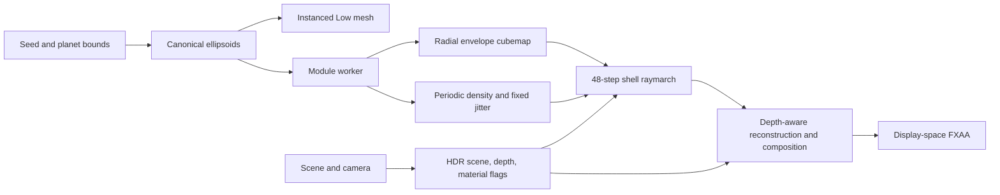

# Math and rendering technique

This document describes the implementation in this repository, including its shortcuts. It is an artistic cloud renderer for a small spherical world, not a fluid or weather simulation. The full implementation is in [src/](../src/); the formulas below use the same defaults and coordinate conventions.

## 1. A shared geometric definition

A field is generated once from a seed. Each puff is an oriented ellipsoid with center **c**, three orthonormal basis vectors **e₀, e₁, e₂**, radii **r₀, r₁, r₂**, and a density multiplier **d**.

For a point **p**, define its normalized puff coordinates:

```text
qᵢ = dot(p − c, eᵢ) / rᵢ
inside(p) ⇔ q₀² + q₁² + q₂² < 1
```

Low renders this ellipsoid directly. High uses its radial extent to build a compact shape field, then erodes that shape with noise. The two modes share placement, seed, and motion; they are not expected to produce identical silhouettes or opacity.

The coordinator assumes a planet centered at the world origin. The puff's second axis is radial; the first and third are tangent to the sphere. World lengths are small-world scene units. Defaults were validated around terrain radii 30, 43, and 62; constants such as a five-unit cloud altitude do not automatically scale with planet radius.

### Seeded regional layout

[cloud-layout.js](../src/cloud-layout.js) uses an unsigned 32-bit linear congruential generator:

```text
state₀ = seed XOR 0xa53c94d7
stateₙ₊₁ = (1664525 stateₙ + 1013904223) mod 2³²
random = state / 2³²
```

There are 24 banks, six of each family: wisp, streak, broken, and billow. Four regions contain **11, 7, 5, and 1** banks, subdivided into groups **[6,3,2], [4,2,1], [3,2], [1]**. The first region center is random; subsequent centers choose among 24 spherical candidates by maximizing their minimum separation from earlier centers.

A region receives a shuffled development depth from **[1, 0.66, 0.36, 0.16]** and moisture **0.3 + 0.65 × depth**. Groups share these large-scale properties with bounded variation. Bank centers are placed along curved fronts in local tangent frames. For center direction **n**, tangent vectors **e, f**, and local offsets **a, b**, placement uses:

```text
direction = normalize(n + a e + b f)
```

This is normalized tangent displacement, not a geodesic exponential map. Family-specific dimensions produce flat wisps, long streaks, fragmented groups, and taller billows. Development affects height; moisture affects density. Adjacent banks therefore feel related, while large clear areas remain.

The canonical puff count is bounded at 180. A 96-direction Fibonacci probe estimates a conservative clear-sky direction for diagnostics; it is not an exact maximum empty-cap solver.

### Bounds and terrain clearance

The nominal cloud radius is **terrainRadius + 5**. Vertical puff radii are capped at 3.05; tangent radii are additionally constrained to stay below the outer radial budget.

For a puff whose center lies at radius **R**, with radial radius **rᵧ** and largest tangent radius **rₜ**, a conservative inner bound is **R − rᵧ**. The exact outer radial extremum for this aligned ellipsoid comes from:

```text
F(y) = (R + rᵧ y)² + rₜ² (1 − y²),  −1 ≤ y ≤ 1

y* = min(1, R rᵧ / (rₜ² − rᵧ²))   if rₜ² > rᵧ²
y* = 1                              otherwise

outerRadius = sqrt(F(y*))
```

Take the minimum inner bound and maximum outer bound across puffs. These bounds enclose the actual surfaces and support both ray clipping and a rotation-invariant bounding sphere. Regression tests sample ellipsoid surfaces and enforce clearance over many seed/radius combinations.

## 2. Motion without re-baking

Both qualities use the same world rotation **W**:

```text
Euler.x = sin(time × 0.002) × 0.018
Euler.y = time × 0.0025
Euler.z = cos(time × 0.0015) × 0.012
```

Low applies **W** to its group. High evaluates density at **W⁻¹(p − planetCenter)**. Rotating the lookup coordinates moves both the envelope and density detail together. No texture upload, geometry regeneration, or worker restart is required for wind.

This is rigid advection around the planet, without evolving turbulence or differential wind shear. Time is advanced only by the supplied nonnegative finite dt; pass zero to pause it.

## 3. Low: one instanced surface draw

[cloud-low.js](../src/cloud-low.js) shares a unit sphere with 10 longitude and 7 latitude segments: **120 triangles per puff**. An instance matrix supplies its basis, radii, and position. At the maximum count, that is 21,600 triangles in one configured draw.

Normal transformation uses cofactors, equivalent to an inverse transpose for these positively oriented nonuniform scales. For matrix columns **m₀,m₁,m₂** and unit-sphere normal **n**:

```text
normal ∝ cross(m₁,m₂)n.x + cross(m₂,m₀)n.y + cross(m₀,m₁)n.z
```

After normalization and the wind rotation, a broad radial ambient term and a Lambert sunlight term are evaluated at vertices. The fragment shader adds a small forward-lit rim. Opacity is:

```text
alpha = 0.8 × puffDensity × smoothstep(0, 0.24, abs(dot(normal, viewToCamera)))
```

The grazing-angle fade softens the polygonal edge. This is a surface approximation, not Beer–Lambert integration: overlapping puffs accumulate alpha according to the chosen blend order.

### Sorting, culling, and inside cameras

Opaque depth testing remains enabled; cloud depth writing is disabled. Instances are stably insertion-sorted **far to near by camera-space center Z**, with original index breaking near ties. Euclidean distance is not the correct sort key for a perspective image.

The renderer reuses typed arrays. It only re-sorts when the relative camera/group transform changes. It uploads matrices and densities only when order changes, and inside flags only when order or containment changes. Stable insertion sort is inexpensive for slowly changing order at this small count; its worst case remains quadratic.

Usually hardware back-face culling selects the front surface. When the camera enters any puff, the material switches to a single-pass double-sided variant. The shader retains only front surfaces of outside puffs and back surfaces of containing puffs. It never blends both surfaces of the same puff.

Center sorting is approximate for intersecting transparent ellipsoids. Low may show overlap ordering errors and faceting close to a puff. Its cost can also become fill-rate limited when many large puffs overlap on screen.

## 4. High: compress shape into a radial cubemap

The worker converts up to 180 ellipsoids into a **128² × 6 RGBA8 envelope**. That removes a puff loop from every raymarch step.

Write the ellipsoid as a quadratic form:

```text
A = Σᵢ (eᵢ eᵢᵀ) / rᵢ²
(p − c)ᵀ A (p − c) ≤ 1
```

For the radial line **p = t n**, where **n** is a unit direction from the planet center:

```text
a = nᵀ A n
b = −nᵀ A c
k = cᵀ A c − 1
D = b² − a k

intersection radii = (−b ± sqrt(D)) / a
```

Reject a direction outside a conservative puff cone before evaluating the quadratic. Reject **D ≤ 0**, negative radii, and intervals outside the cloud shell. The cone is only a cheap broad-phase test; the quadratic determines the intersection.

For every valid puff interval along a direction:

- Keep the smallest lower radius and largest upper radius.
- Take the maximum density multiplier.
- Compute angular edge coverage **smoothstep(0,1,(D/a)/0.15)** and take the maximum coverage.

Since **D/a = 1 − qmin**, coverage is tied to how deeply the radial line passes through the ellipsoid in its normalized metric.

### Premultiplied encoding

Let coverage be **C**, density multiplier **d**, shell bounds **Ri, Ro**, lower and upper puff radii **l, u**. Store:

```text
RGBA = [ C (l − Ri)/(Ro − Ri),
         C (u − Ri)/(Ro − Ri),
         C d,
         C ]
```

Clamp to [0,1], multiply by 255, and round. Empty texels are all zero. On the GPU, divide RGB by alpha before decoding radii and density. This matters at filtered cloud edges: blending a valid texel with empty space reduces coverage without dragging its decoded heights toward the shell bottom.

All envelope textures are data, with no color-space conversion and no mipmaps. Hardware linear filtering is used.

### Cubemap orientation

Faces are ordered **+X, −X, +Y, −Y, +Z, −Z**. For coordinates **u,v ∈ [−1,1]**, normalize:

| Face | Unnormalized direction |
| ---- | ---------------------- |
| +X   | (1, −v, −u)            |
| −X   | (−1, −v, u)            |
| +Y   | (u, 1, v)              |
| −Y   | (u, −1, −v)            |
| +Z   | (u, −v, 1)             |
| −Z   | (−u, −v, −1)           |

Bake at texel centers, not edges. Tests compare shared-edge directions, corners, all encoded texels of a reference case, and interpolation against empty samples.

### What compression loses

The envelope stores **one radial interval per direction**. If two clouds are separated vertically along that direction, their min/max union fills the gap. Density is a maximum, not an additive sum or an exact mixture. Thin angular features can be lost in a 128² face; heights and density are quantized to eight bits. Low and High intentionally diverge in these cases.

## 5. Periodic 3D noise

[cloud-volume-data.js](../src/cloud-volume-data.js) bakes one **64³ R8** texture in the worker. Runtime density uses a trilinear texture lookup instead of evaluating procedural noise repeatedly.

The gradient-noise component uses 12 lattice gradient directions and the quintic interpolation curve:

```text
fade(t) = 6t⁵ − 15t⁴ + 10t³
P = clamp(0.5 + 0.65 (0.625 P₄ + 0.25 P₈ + 0.125 P₁₆), 0, 1)
```

The subscripts are periodic lattice frequencies over one texture tile. Integer lattice indices wrap; the hash and gradient tables are seeded.

The cellular component uses one hashed feature point per cell of a periodic frequency-four lattice. It finds the closest feature distance **F₁**, then computes:

```text
Worley = 1 − clamp(F₁ / sqrt(3), 0, 1)
Noise = clamp(0.65 P + 0.35 Worley, 0, 1)
```

The normal search checks 27 neighboring cells. If the current nearest squared distance exceeds one, a second ring is checked where a cell's distance bound could improve the candidate. This handles rare cases missed by blindly assuming the first ring always contains the nearest feature.

Samples are stored at voxel centers. Wrapping integer lattice coordinates makes the continuous sampler periodic for negative coordinates and across every axis. The first and last voxel slices need not be identical: they represent different centers on opposite sides of the seam. Tests check both continuous periodicity and the size of the filtered seam relative to neighboring slices.

The baked texture uses repeat wrapping, linear filtering, and no color conversion or mipmaps.

## 6. Density evaluation

Transform the world sample into the stationary field:

```text
x = W⁻¹ (worldPosition − planetCenter)
radius = length(x)
direction = x / radius
```

Reject shell-exterior points, almost-empty envelope texels, and samples outside the decoded lower/upper interval before fetching 3D noise.

Let **h = (radius − lower)/(upper − lower)**. The vertical shape is:

```text
H(h) = smoothstep(0, 0.18, h) × [1 − smoothstep(0.72, 1, h)]
rho = d × clamp(
  [C H(h) − erosion × (1 − Noise(x / wavelength))] / (1 − erosion),
  0, 1
)
```

The implementation clamps the denominator to at least 0.001. Coordinator defaults are **wavelength = 4.5**, **erosion = 0.25**, **extinction = 0.8**. Direct use of the High factory has a wavelength default of **3.6** for historical reasons; pass the coordinator's CLOUD_CONFIG to match its appearance.

Coverage controls large-scale shape; noise removes material near low-density regions, adding uneven edges. This is an erosion model, not a fractal sum of unbounded density evaluations. A single noise tile can repeat visibly in prolonged close views.

## 7. Ray construction and shell clipping

High captures the opaque depth buffer of the scene. Depth is conventional WebGL depth in [0,1]. Reconstruct a point by mapping depth to NDC z = **2 depth − 1**, applying the inverse projection matrix, dividing by homogeneous w, and applying the camera's world matrix.

For perspective cameras, the ray starts at the camera position. For orthographic cameras, it starts at the unprojected near-plane point. The direction is the normalized far-minus-near vector. Convert the reconstructed scene position to ray distance by projection onto that direction.

For a normalized ray **o + t v** relative to the planet center and sphere radius **R**:

```text
b = dot(o,v)
D = b² − (dot(o,o) − R²)
t = −b ± sqrt(D)
```

Intersect the outer sphere, clip to nonnegative distance and scene depth, and subtract the inner-sphere interval. The result contains **zero, one, or two** cloud intervals. Subtracting the inner sphere avoids spending steps in the empty space between near-side and far-side clouds.

Do not replace this with a single near/far box march: it wastes work through the planet's cavity and breaks inside-shell views.

## 8. Bounded integration and lighting

Let valid segment lengths be **L₀,L₁**. Total length is **L = L₀ + L₁**; the step length is **ds = L/48**. A fixed blue-noise sample **j** offsets positions in cumulative interval space:

```text
sᵢ = (i + j) ds,  i = 0…47
tᵢ = start₀ + sᵢ                  when sᵢ < L₀
tᵢ = start₁ + (sᵢ − L₀)           otherwise
```

There are 48 samples **total**, not 48 per interval. This bounds work but undersamples long grazing paths and very thin features. There is no adaptive stepping.

The 32² fixed rank mask has four occurrences of every byte value. There is no frame index or time in the jitter lookup. A stationary view avoids temporal flicker; motion can still reveal static grain and spatial aliasing. No temporal history or accumulation is maintained.

### Beer–Lambert accumulation

For extinction coefficient **sigma**, local density **rho**, and source color **S**:

```text
alpha = 1 − exp(−sigma rho ds)
weight = T alpha
Lrgb ← Lrgb + weight S
T ← T (1 − alpha)
```

Start with **Lrgb = 0, T = 1**. Skip effectively empty samples. Stop when **T < 0.02**. Output cloud radiance **Lrgb** and opacity **1 − T**. Radiance is already weighted by transmittance; do not alpha-multiply it again during composition.

The source is an ambient approximation plus single sunlight scattering:

```text
S = ambientColor × 0.62 × [0.72 + 0.28 max(dot(radialNormal,sunDirection),0)]
  + sunColor × 2.7 × HG(mu,g) × Tsun

HG(mu,g) = (1 − g²) / [4π (1 + g² − 2g mu)^(3/2)]
mu = dot(viewRay, sunDirection)
g = 0.4
```

Both directions in the dot product point away from the camera/sample toward what they see. Looking toward the sun gives positive mu and the forward-scattering lobe. The shader guards the phase denominator.

For sunlight attenuation, first test whether the ray toward the sun hits the solid planet sphere. If so, direct sunlight is zero. Otherwise integrate **two midpoint samples** over the smaller of the outer-shell exit distance and **shadowDistance = 12**:

```text
segment = limit / 2
rhoA = densityAt(p + sunDirection × 0.5 segment)
rhoB = densityAt(p + sunDirection × 1.5 segment)
Tsun = exp(−sigma (rhoA + rhoB) segment)
```

These two samples are a coarse local self-shadow estimate, not a converged light integral. There is no terrain-to-cloud occlusion beyond the solid sphere, no multiple scattering solve, and no cloud shadow projection onto the scene.

## 9. Resolution, metadata, and reconstruction

For drawing-buffer dimensions **W,H**, cloud dimensions are:

```text
s = min(0.5, sqrt(262144 / (W H)))
w = max(1, floor(W s))
h = max(1, floor(H s))
```

At 1920 × 1080 this yields **682 × 384**. A conservative projected shell rectangle scissor-limits the raymarch. Inside/crossing-near-plane cases use the full viewport. Frustum rejection can skip the High pipeline altogether.

The raymarch writes two RGBA16F attachments:

1. **Radiance RGB + opacity**.
2. **Opacity-weighted representative distance, scene ray distance, first-cloud distance, opacity**.

Distances are divided by **max(1, 4 × camera.far, 4 × outerRadius)** to keep large distances within half-float range. Representative distance is the weighted sum of sample distances divided by opacity.

The full-resolution reconstruction inspects a 2 × 2 neighborhood. It recomputes the valid shell interval against the full-resolution scene depth and rejects cloud samples behind foreground geometry. Depth tolerance is:

```text
tolerance = 0.24 + 0.006 × max(1, fullSceneDistance)
```

A reference representative depth is chosen from eligible occupied neighbors. Reconstruction multiplies bilinear weights by scene-depth similarity and cloud-depth similarity:

```text
w = wBilinear
  × exp(−abs(lowSceneDistance − fullSceneDistance) / tolerance)
  × exp(−abs(cloudDistance − referenceDistance) / max(1, 0.025 referenceDistance))
```

The final cloud-depth factor applies to occupied samples. Samples whose entry/representative depth would put them behind the foreground are rejected; the reference search also limits scene-depth mismatch. If no valid weights remain, the cloud contribution is zero.

This limits silhouettes leaking over terrain, but is not a general solution to subpixel geometry or transparency. Detailed foreground edges and long thin clouds can still show holes, soft edges, or grain.

## 10. Composition, output color, and scene compatibility

The intended radiometric composition is:

```text
linearCombined = cloudRadiance + cloudTransmittance × linearScene
```

High captures the scene once into HDR without the renderer's tone/output transforms, then performs the transform once after cloud composition. Low lets its normal Three.js material chunks perform the usual transform.

Ant-world also contains authored materials with tone mapping disabled, literal display outputs, fog exclusions, and artistic haze. To retain their appearance, High patches scene materials to write a second attachment with fog/tone/literal-output flags. Existing material compilation hooks are preserved and restored on disposal or failure.

- Linear sRGB is the required working color space.
- Supported tone operators are ACESFilmicToneMapping and NoToneMapping.
- Output supports sRGB, linear sRGB, Display P3, and linear Display P3.
- Authored fog is removed during capture and reapplied in display space, weighted by cloud transmittance and the material fog flag.
- Optional artistic limb haze is similarly composed using a spherical projected-height model.
- Per-material output corrections are **approximate for overlapping transparent materials with different flags**, especially additive effects.

### Why the clear color needs an inverse

The existing renderer's authored clear color does not follow the same material tone-mapping path. Applying ACES to that clear color again in the cloud composite would change the background. High compensates by inverting the fitted ACES transform before capture.

The per-channel rational fit is:

```text
f(x) = [x(x + 0.0245786) − 0.000090537]
     / [x(0.983729 x + 0.4329510) + 0.238081]
```

Set **f(x)=y**, collect the quadratic coefficients, and choose the positive solution. Apply inverse output/input matrices in the opposite order from the forward transform, then multiply by **0.6/exposure**. The constants and their notices are credited in [Third-party notices](../THIRD_PARTY_NOTICES.md).

Only positive exposure and finite compensated clear components in [0,1] are accepted; unsupported values cause a Low fallback. This compensation is specifically tied to the fitted ACES used by r169, not an arbitrary invertible tone operator.

### Final FXAA

The final pass operates on the composed display-space image. It uses center and diagonal-neighbor luminance to detect contrast, estimates an edge direction, clamps its span to eight pixels, and chooses between a narrower two-tap and wider four-tap filter according to the original luminance range. The alpha channel is taken from the center.

There is no second tone transform or color encoding in this pass. FXAA smooths edges but can soften fine details; it does not restore missing raymarch samples.

## 11. Pipeline and resource lifetime



The worker starts only after visible High is requested. It transfers six envelope buffers, one density buffer, and one jitter buffer, then terminates. Low remains available. A stale response cannot revive a disposed system.

Targets allocate lazily on the first viable High frame, and are replaced only when drawing-buffer dimensions change. Selecting Low or hiding clouds retains warmed High resources for a cheap return; call dispose to release them. Resize notifications while hidden do not allocate targets.

High owns the complete render call. Its pass sequence is scene capture, raymarch, reconstruction/composition, output FXAA. The last three are cloud postprocess draws; the scene capture still contains the application's normal draw calls.

## 12. Deliberate limits

This implementation trades generality for small bounded work. It has a single planet-centered shell, a single radial interval per angular direction, fixed resolution textures, fixed primary/light sample counts, and no history buffer. The Low mode is a surface approximation and the High mode is a sparse approximation to radiative transport.

For arbitrary worlds, large physical units, multiple planets in one frame, WebXR, custom render graphs, or complex transparent effects, use the low-level pieces as a starting point and validate the changed contracts. See [Integration](INTEGRATION.md) and [Performance](PERFORMANCE.md) before treating the coordinator as a general postprocessing library.
